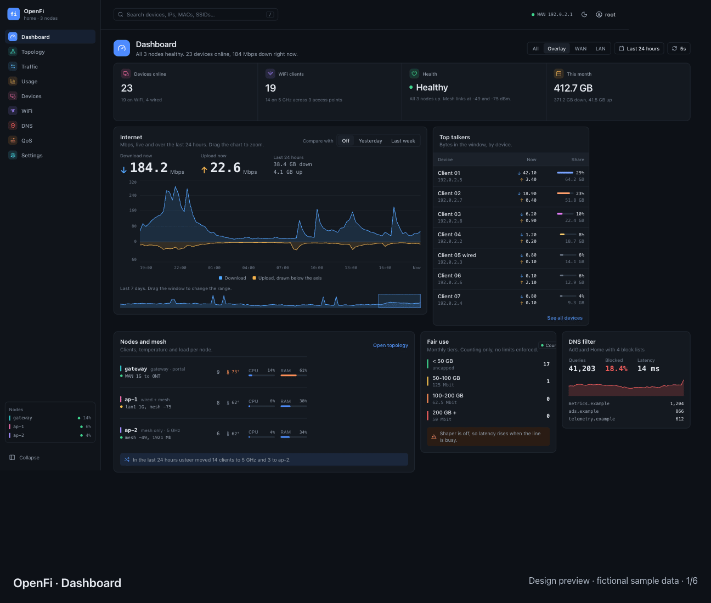

# OpenFi

An open source dashboard and configuration interface for OpenWrt, built with Rust and Preact. One controller runs on the gateway and polls local ubus and remote rpcd nodes; the web UI is embedded in the binary.

**Status: experimental, pre-1.0.** Full feature parity with core LuCI is the project goal. It is not complete today. Keep LuCI available for recovery and configuration workflows that OpenFi does not yet cover. OpenFi is an independent project, not an official OpenWrt or Ubiquiti product.

## Demo

Looping slideshow of the Pen design's exported screens: dashboard, topology, devices, usage, Wi-Fi, and Wi-Fi networks. These are design previews with fictional sample data; they do not establish implemented feature coverage.



[View the static screens](docs/demo/README.md) for a non-animated preview.

## What works today

- Dashboard, clients, traffic and usage, Wi-Fi and topology views.
- Node management, logs, diagnostics, reboot, client kick and DHCP reservation actions.
- Radio changes and staged Wi-Fi plans with apply/rollback handling.
- Sessions, write-request protection, audit records, and an optional browser shell.
- Optional DNS statistics through AdGuard Home and usage/QoS integrations; these are not a general DNS or firewall configuration editor.

These capabilities are present in source and mock mode. Compatibility and behavior on your router require validation. See the [LuCI parity matrix and milestones](docs/luci-parity.md) for current coverage and contributor tasks. Network, firewall, package management, backup/restore, and firmware workflows still need substantial work.

## Try locally

Prerequisites: Git, Rust stable with edition 2024 support, Node.js 22.12+ and npm. Build the frontend before Rust so the embedded UI exists.

```sh
git clone https://github.com/wpfyorg/OpenFi.git
cd OpenFi
npm ci --prefix web
npm run --prefix web build
cargo run --locked -- --mock fixtures --listen 127.0.0.1:8088
```

Open <http://127.0.0.1:8088>. Mock mode accepts username `root` and password `mock`; it uses synthetic fixtures and must remain local. It is for development, not a deployment authentication model.

```sh
cargo fmt --check
cargo test --locked
npm run --prefix web build
```

## Run on OpenWrt

No packaged release or universal hardware support is promised yet. The existing deployment helper targets **aarch64 Linux musl** and requires `cargo-zigbuild`, Zig and SSH access. Other architectures need their own target/build validation.

Read [deployment and configuration](docs/deployment.md) before running the helper. It replaces the binary and service on the specified router and restarts the service. Review your configuration and retain a recovery path.

The executable, service, config filenames, Cargo package and API header retain `openwrtfi` / `OpenWrtFi` for compatibility. The project and UI use **OpenFi**.

## Contribute and get help

- [Contributing](CONTRIBUTING.md): setup, tests, review and pull requests.
- [LuCI parity roadmap](docs/luci-parity.md): coverage, priorities and acceptance criteria.
- [API reference](docs/api.md) and [architecture / implementation plan](plan.md).
- [Support and bug reporting](SUPPORT.md); [security reporting](SECURITY.md).
- [Code of conduct](CODE_OF_CONDUCT.md); [maintainer launch steps](docs/public-release.md).

Use synthetic data in reports and pull requests. Remove passwords, session cookies, tokens, identifying device data and private network captures before sharing.

## License

[MIT](LICENSE), matching the existing Cargo metadata. Dependencies keep their own licenses. Any future imported LuCI code or assets must preserve the applicable upstream license and notices; backend interoperability does not grant permission to relicense upstream code.
