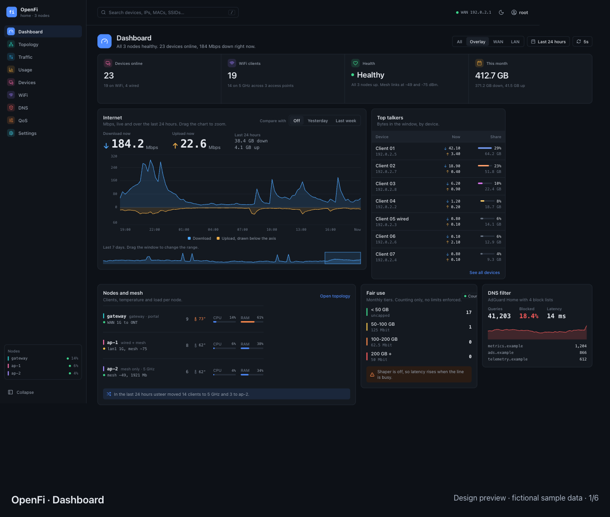
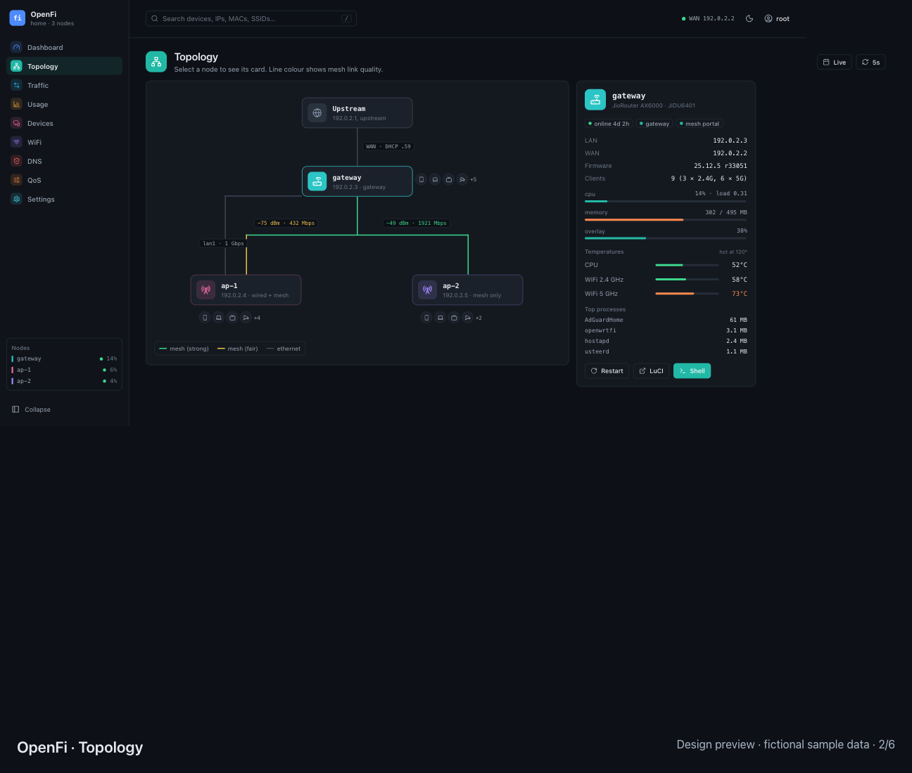
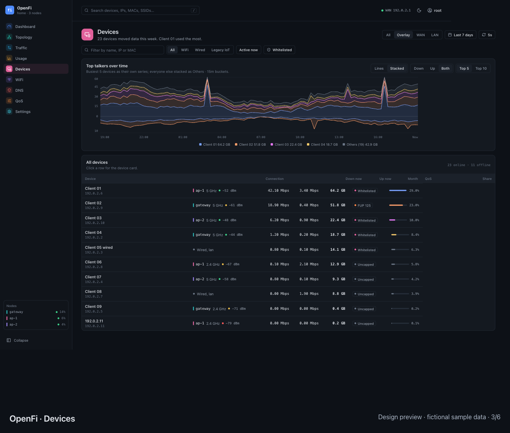
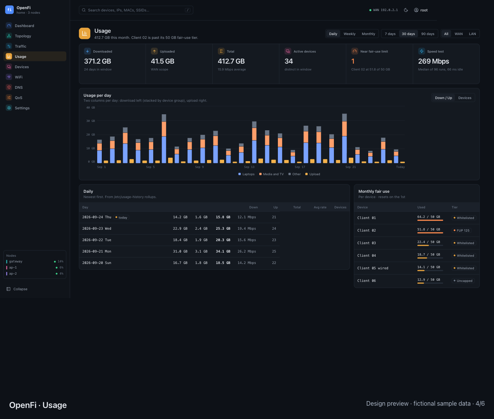
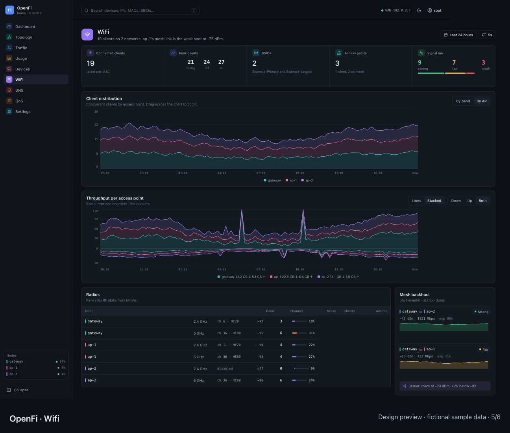
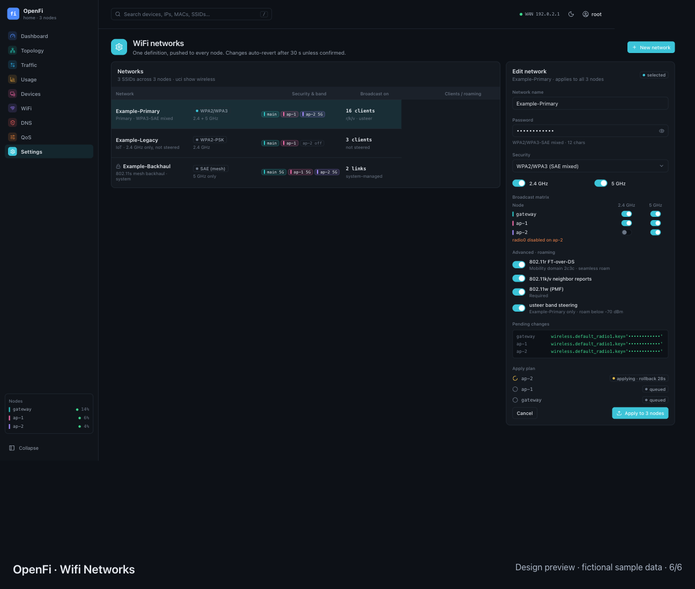

# Design preview

Static screens from the Pen design exports. Names, addresses, SSIDs, and queried domains use fictional samples. Design previews show the intended interface; consult the [LuCI parity matrix](../luci-parity.md) for implemented coverage.

The [README slideshow](../../README.md#demo) loops through these six screens, four seconds per screen.

## Dashboard

## Topology

## Devices

## Usage

## Wi-Fi

## Wi-Fi networks

